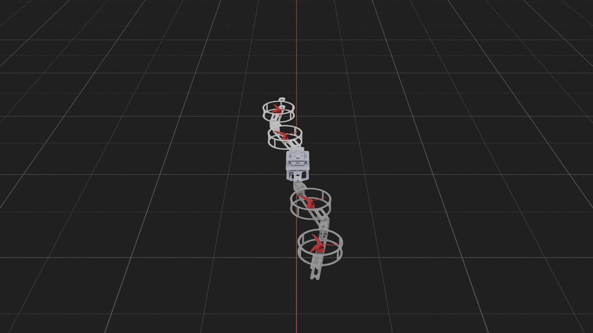

# AeroMorph 空中变构无人机

本项目为 AeroMorph 空中可变构无人机的仿真与飞行控制训练。

## 一、环境配置

本项目基于 Issaclab 仿真环境开展，环境配置参考网站 `https://docs.robotsfan.com/isaaclab/index.html`

## 二、模型展示

- 模型包含 9 个连杆和 8 个活动关节
- `joint1`、`joint2`、`joint3`、`joint4` 是变构关节，`fly_joint1`～`fly_joint4` 是旋翼关节

在 rviz2 中进行模型展示
```bash
colcon build --packages-select aeromorph_description
source install/setup.bash

ros2 launch aeromorph_description display.launch.py
```

rviz2 中模型展示如下：


在 Isaac Lab 中展示模型：

```bash
colcon build --packages-select aeromorph_description
source install/setup.bash

ros2 launch aeromorph_description isaaclab.launch.py
```

拖动 `AeroMorph joints` 面板的 `joint1 ~ joint4` 四个滑块，即可改变相应关节角度

Isaaclab 中模型展示如下：


## 三、基本飞行控制

```bash
colcon build --packages-select aeromorph_description
source install/setup.bash
ros2 launch aeromorph_description flight.launch.py
```

默认使用 `cuda:0` 进行 GPU 物理仿真；如需 CPU，可加 `device:=cpu`。
飞行窗口使用深灰背景和网格，初始相机在无人机后上方，沿初始前进方向观察。

- 点击视口，使用 W/S 前后、A/D 左右、R/F 升降；松键或按 H 制动悬停。
- 右侧 `AeroMorph flight` 面板提供 `joint1`～`joint4` 滑块，可在飞行中设置变构目标。
- 四个螺旋桨按各自实时推力自动切换低、中、高显示转速，面板显示当前档位；动画仅影响外观。
- 关节通过有限力矩舵机平滑运动，默认最大参考速度 `0.08 rad/s`、加速度 `0.08 rad/s²`。
- 不可飞目标或不可行变构路径会被拒绝，并在面板显示原因；实际角度与滑块目标分别显示。

启动方法、变构保护、参数和验证说明见 [isaaclab/FLIGHT.md](isaaclab/FLIGHT.md)。

GPU 飞行中的后方视角与变构效果：


## 目录

```text
AeroMorph/
├── src/aeromorph_description/  # ROS 2 模型包
│   ├── CMakeLists.txt
│   ├── package.xml
│   ├── launch/                # RViz2 和 Isaac Lab 的 ROS 2 启动入口
│   ├── meshes/                # 9 个原始 STL 网格
│   ├── rviz/                  # RViz2 显示配置
│   └── urdf/                  # 机器人结构与物理参数
├── isaaclab/scripts/          # 模型展示、飞行与变构验证入口
├── isaaclab/aeromorph_control/ # 飞控、关节模型、变构规划及实际受力
├── isaaclab/configs/          # 构型、旋翼、舵机及控制参数
├── report.md                 # 动力学及强化学习实施路径
├── build/                     # 自动生成的构建文件
├── install/                   # 自动生成的 ROS 2 安装空间
└── log/                       # 构建及运行日志
```


