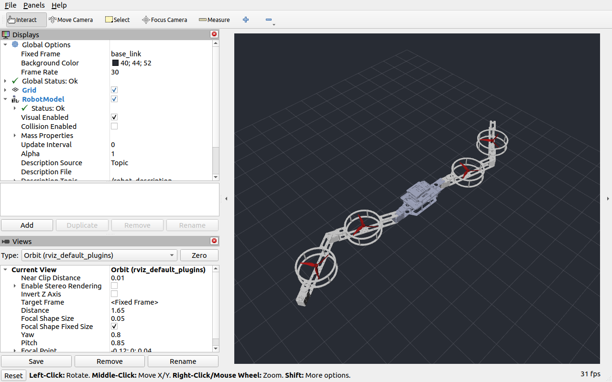
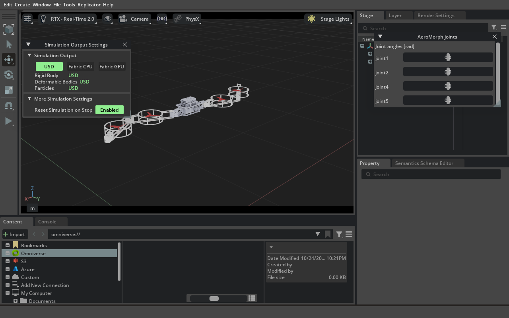

# AeroMorph 空中变构无人机

本项目为 AeroMorph 空中可变构无人机的仿真与飞行控制训练。

## 一、环境配置

本项目基于 Issaclab 仿真环境开展，环境配置参考网站 `https://docs.robotsfan.com/isaaclab/index.html`

## 二、模型展示

- 模型包含 9 个连杆和 8 个活动关节
- `joint1`、`joint2`、`joint3`、`joint4` 是变构关节，`fly_joint1`～`fly_joint4` 是旋翼关节

在 rviz2 中进行模型展示
```bash
colcon build --packages-select aeromorph_description
source install/setup.bash

ros2 launch aeromorph_description display.launch.py
```

rviz2 中模型展示如下：


在 Isaac Lab 中展示模型：

```bash
colcon build --packages-select aeromorph_description
source install/setup.bash

ros2 launch aeromorph_description isaaclab.launch.py
```

拖动 `AeroMorph joints` 面板的 `joint1 ~ joint4` 四个滑块，即可改变相应关节角度

Isaaclab 中模型展示如下：


## 三、基本飞行控制

## 目录

```text
AeroMorph/
├── src/aeromorph_description/  # ROS 2 模型包
│   ├── CMakeLists.txt
│   ├── package.xml
│   ├── launch/                # RViz2 和 Isaac Lab 的 ROS 2 启动入口
│   ├── meshes/                # 9 个原始 STL 网格
│   ├── rviz/                  # RViz2 显示配置
│   └── urdf/                  # 机器人结构与物理参数
├── isaaclab/scripts/          # Isaac Lab 模型展示入口
├── report.md                 # 动力学及强化学习实施路径
├── build/                     # 自动生成的构建文件
├── install/                   # 自动生成的 ROS 2 安装空间
└── log/                       # 构建及运行日志
```


